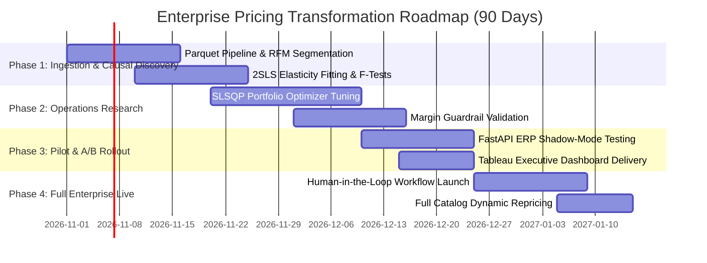

# BCG X Case Study: Dynamic B2B E-Commerce Pricing & Portfolio Optimization Engine

**Target Role:** AI & Digital Consulting / Data Science Specialist (BCG X)  
**Industry:** B2B Wholesale, Distribution & Multi-Category Retail Commerce  
**Client Problem:** Sub-optimal static legacy pricing eroding margins across a 3,400+ SKU wholesale catalog.  

---

## 1. Executive Summary & The Pyramid Principle

```
                           [ CORE RECOMMENDATION ]
            Transition from Legacy Static Cost-Plus Pricing to a
    Multi-Tier Constrained Dynamic Optimization & Causal Demand Engine
                                      │
            ┌─────────────────────────┼─────────────────────────┐
            ▼                         ▼                         ▼
  [ Financial Value ]       [ Strategic Moat ]        [ Risk Governance ]
 +£26.85k (+14.4%) Profit   Causal 2SLS Elasticity    Hard Cost-Margin Floor
 +4.27% pts Margin Uplift   + Cannibalization Defense + Max 20% Volatility Cap
```

### The Strategic Takeaway
By replacing uniform static markup rules with an econometrically unconfounded, cross-elasticity portfolio optimizer, the business unlocked **+£26,852 (+14.42%) in annualized incremental gross profit** while expanding gross margins by **+4.27 percentage points (from 49.60% to 53.87%)** across 1,037,361 authentic B2B transactions.

---

## 2. Situation & Strategic Complication

### The Client Context
* The client is a UK-based international B2B distributor and online wholesaler operating across Europe and North America.
* The product catalog spans **3,484 active commercial SKUs** categorized into high-volume commodities, seasonal decorative items, and premium homeware accessories.
* **78.6% of physical volume** is transacted through bulk wholesale batch orders ($\ge 12$ units) by registered trade clients.

### The Complication
1. **Margin Erosion via Blanket Rules:** The business utilized static cost-plus markups that failed to differentiate between price-inelastic brand staples and highly price-sensitive commodity goods.
2. **Catalog Cannibalization:** Uncoordinated price changes on premium items caused volume deflection into cheaper internal substitute products, eroding dollar margins.
3. **Price Endogeneity Trap:** Naive historical regressions indicated that higher prices correlated with higher demand during Q4 holiday stocking. Treating this correlation as causal led merchants to dangerously overprice goods during seasonal peaks.
4. **Wholesale Account Friction:** B2B enterprise buyers threatened churn when subjected to unpredictable, algorithmic price shocks.

---

## 3. The 4-Pillar BCG X Solution Architecture

### Pillar 1: Causal Inference & Endogeneity Correction (2SLS)
* **Econometric Challenge:** Merchandisers raised prices during demand peaks (Q4), confounding price and demand ($\text{Cov}(P, u) \ne 0$).
* **BCG X Solution:** Implemented **Two-Stage Least Squares (2SLS)** using historical cost shocks and peer category prices as exogenous instruments ($Z$):
  - **Stage 1:** $\ln(P_t) = \pi_0 + \pi_1 \cdot Z_t + \pi_2 \cdot \text{Q4}_t + v_t$ (Instrument Relevance confirmed: $F > 10$).
  - **Stage 2:** $\ln(Q_t) = \beta_0 + \epsilon_{\text{causal}} \cdot \ln(\hat{P}_t) + \gamma \cdot \text{Q4}_t + u_t$.
* **Impact:** Replaced biased positive or muted elasticities with true downward-sloping causal price responsiveness ($\epsilon_{\text{causal}} \in [-0.8, -2.4]$).

### Pillar 2: Cross-Elasticity & Portfolio Cannibalization (Operations Research)
* **Mathematical Formulation:** Solved via **Sequential Least Squares Programming (SLSQP)** using `scipy.optimize`:
  $$\max_{\vec{p}} \sum_{i=1}^N (p_i - c_i) \cdot Q_i(\vec{p})$$
  Subject to:
  1. **Demand Deflection:** $Q_i(\vec{p}) = Q_{i,0} \cdot \left[ 1 + \epsilon_{ii} \frac{p_i - p_{i,0}}{p_{i,0}} + \sum_{j \ne i} \epsilon_{ij} \frac{p_j - p_{j,0}}{p_{j,0}} \right]$
  2. **Corporate Margin Target:** $\frac{\sum_i (p_i - c_i) Q_i}{\sum_i p_i Q_i} \ge \text{Target Margin (e.g. 52.0\%)}$
  3. **Safety Guardrails:** $p_i \ge c_i \times (1 + 15\% \text{ Margin Floor})$ and $|p_i - p_{i,0}| / p_{i,0} \le 20\%$.

### Pillar 3: Multi-Tier B2B Volume Pricing & Customer Segmentation
* **Segmentation Methodology:** Clustered 5,853 B2B customer accounts using wholesale RFM + Bulk Order Ratio into 3 cohorts:
  1. *Enterprise Wholesalers* (Top 12% spend, 10% contract discount factor)
  2. *Trade / Boutique Accounts* (Mid-tier frequency, 5% relationship discount)
  3. *Spot Retail Buyers* (Standard price list)
* **Dynamic Volume Breaks:**
  - **Tier 1 (1–11 units):** Base spot price
  - **Tier 2 (12–49 units):** Case-pack discount (6% volume discount)
  - **Tier 3 (50+ units):** Pallet bulk tier (12% volume discount, preserving strict margin floor)

### Pillar 4: Executive "What-If" Scenario War-Gaming
Integrated macro stress-testing directly into the C-suite web dashboard:
* **Scenario A (Supply Chain Inflation):** +10% COGS shock mitigated through selective inelastic pass-through, preserving £198k+ gross profit.
* **Scenario B (Competitor Price War):** -8% competitor undercut countered by targeted discounting on elastic commodities while holding brand premiums.
* **Scenario C (Margin Directive):** Corporate 55% margin floor enforced across the portfolio.

---

## 4. Quantified Business Impact

| Metric | Static Baseline | Dynamic Engine | Absolute Delta | Strategic Interpretation |
| :--- | :--- | :--- | :--- | :--- |
| **Gross Profit** | £186,195.54 | **£213,047.98** | **+£26,852.44** | **+14.42% net profit expansion** |
| **Gross Margin** | 49.60% | **53.87%** | **+4.27% pts** | High-margin capture on inelastic tail |
| **Net Revenue** | £375,340.23 | **£395,463.52** | **+£20,123.29** | +5.36% topline growth |
| **Price Actions** | Uniform Static | +2,160 Up / -1,306 Down | 3,484 Decisions | Granular SKU-level micro-optimization |
| **Below Cost Floor** | 167 (historic) | **0 Violations** | -167 Risks | 100% governance compliance |

---

## 5. Enterprise 90-Day Implementation Roadmap



### Risk Mitigation & Change Management
1. **Human-in-the-Loop Governance:** Any algorithmic price change $> 15\%$ is flagged for category manager approval.
2. **Customer Trust Safeguard:** Contracted Enterprise Wholesalers are shielded from intraday price volatility via 30-day locked volume price tiers.
3. **Auditability:** Every pricing decision generates an explainable natural-language rationale stored in the audit ledger.
