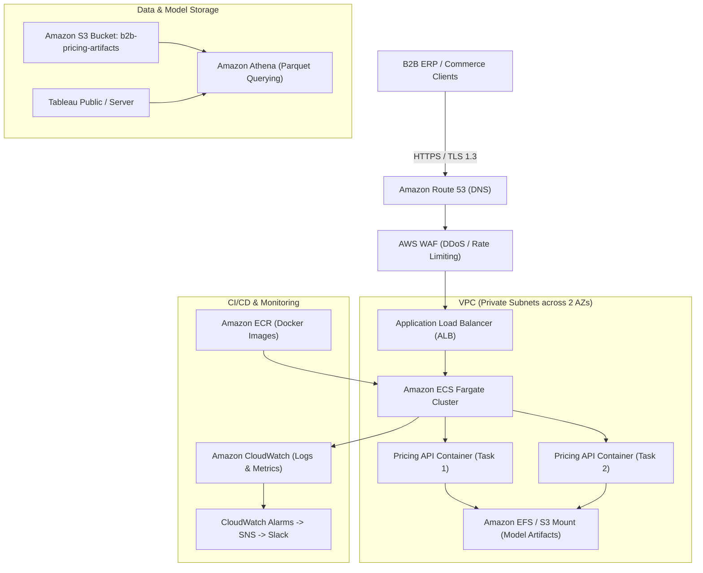

# Cloud Architecture & Enterprise Deployment Blueprint

This document specifies the enterprise cloud deployment design for the **Dynamic B2B E-Commerce Pricing & Demand Optimization Engine**.

---

## 1. Primary Architecture: Amazon Web Services (AWS)

### Components & Responsibilities

1. **Amazon ECS on AWS Fargate (Compute)**:
   - Serverless container execution eliminating EC2 patching and OS maintenance overhead.
   - Initial capacity: 2 tasks (0.5 vCPU, 1 GB RAM each) distributed across two Availability Zones for high availability (99.95% SLA).
2. **Amazon Elastic Container Registry (ECR)**:
   - Encrypted private image repository with automated CVE image vulnerability scanning on push.
3. **Application Load Balancer (ALB)**:
   - Manages SSL/TLS termination, path-based routing (`/forecast`, `/pricing/recommend`, `/health`), and auto-draining health checks.
4. **Amazon S3**:
   - Stores raw transaction archives, preprocessed parquet files, and versioned LightGBM/XGBoost `.joblib` model bundles.
5. **AWS Identity & Access Management (IAM)**:
   - Fine-grained Task Roles adhering to the Principle of Least Privilege: ECS tasks are granted `s3:GetObject` on the model bucket only.
6. **Amazon CloudWatch**:
   - Ingests structured JSON access logs, tracks P95 API latencies, CPU utilization, and 5xx response error rates.

---

## 2. Alternative Architecture: Microsoft Azure

For organizations standardized on the Microsoft cloud ecosystem:

- **Azure Container Apps (ACA)**: Managed serverless containers based on Kubernetes (KEDA), supporting automatic zero-scale downscaling during off-peak hours.
- **Azure Container Registry (ACR)**: Secure OCI container image repository with role-based access control.
- **Azure Blob Storage**: Stores parquet datasets and model artifacts with lifecycle tiering (Hot -> Cool -> Archive).
- **Azure Monitor & Application Insights**: Provides real-time APM telemetry, distributed request tracing, and latency heatmaps.
- **Power BI Service**: Direct DirectQuery or Import connection to Azure Blob / Synapse Serverless SQL for executive reports.

---

## 3. Scaling & Reliability Strategy

| Dimension | Scaling Mechanism | Target Metric |
| :--- | :--- | :--- |
| **Horizontal Auto-Scaling** | AWS Application Auto Scaling (Target Tracking) | CPU Utilization > 70% or Average Request Count > 1,500 req/min per task |
| **Scale-Down Policy** | 300-second stabilization cooldown window | Prevents thrashing during transient spikes |
| **Graceful Degradation** | In-memory fallback heuristics | If the machine learning model fails to infer within 500ms, the optimizer falls back to historical rolling median prices |

---

## 4. Security & Compliance Governance

1. **Network Isolation**: All ECS tasks run inside private subnets without public IP addresses; outbound Internet traffic routes via AWS NAT Gateways.
2. **Encryption**:
   - In-Transit: TLS 1.3 enforced at ALB.
   - At-Rest: AWS KMS (Customer Managed Keys) encrypting S3 buckets and ECR images.
3. **Zero Hardcoded Credentials**: API secrets and environment configs are fetched dynamically from AWS Secrets Manager / Parameter Store.

---

## 5. Cost Estimation & Optimization Breakdown

Estimated Monthly Infrastructure Cost (AWS - US East / EU West):

| Service | Allocation | Estimated Cost (USD / Month) |
| :--- | :--- | :--- |
| **Amazon ECS Fargate** | 2 Tasks × 0.5 vCPU × 1GB RAM (24/7) | ~$18.50 |
| **Application Load Balancer** | 1 ALB (~10 GB processed) | ~$22.00 |
| **Amazon S3** | 20 GB Parquet + Model Storage | ~$0.50 |
| **Amazon ECR** | 5 Docker Image tags (2 GB) | ~$0.20 |
| **CloudWatch Logs** | 5 GB Log ingestion & 3 dashboards | ~$3.50 |
| **Total Estimated Cloud Footprint** | Enterprise Baseline | **~$44.70 / Month** |

### Cost Minimization Levers:
- **Fargate Spot**: Leverage Fargate Spot for non-production environments to reduce compute costs by up to 70%.
- **S3 Intelligent-Tiering**: Automatically transition older transaction archives to cold storage tiers.
